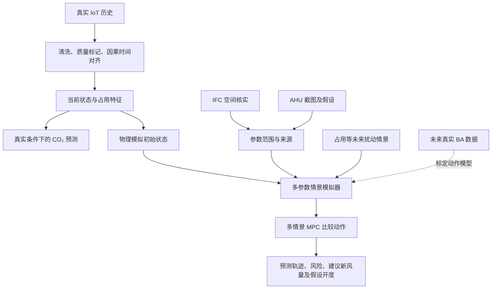

# ZB202 方法方案：真实数据预测、物理情景模拟与新风决策

状态：供审阅的方法草案，未实施本文件中的新增算法。调研日期：2026-10-17。

## 1. 推荐结论

采用“真实观测预测 + 参数不确定的 CO₂ 灰箱模拟器 + 多情景 MPC”组合。用 BIM 提供经核实的空间先验，用真实 IoT 约束当前状态和可辨识参数，用 AHU 假设提供动作响应；未来 BA 数据进入后再标定动作模型。

这不是某一篇论文的现成算法，而是根据 ZB202 数据条件组合的方法。现阶段交付应称为“数据辅助的通风情景模拟与建议原型”。真实预测能力与假设控制效果分别验证、分别报告。

第一阶段目标为 CO₂，温湿度保留为观测及辅助特征。没有室外状态和真实 HVAC 数据时，不宣称完成热湿舒适优化或节能控制。第一版无需强化学习、复杂 PDE 或大型时间序列基础模型。

## 2. 项目现状与证据边界

- 真实数据：当前快照有 949,752 条字段观测，时间约为 2026-08-13 至 2026-10-16。字段行数不是独立训练样本数。
- 五个环境点位：四个 AM103 的 CO₂ 典型间隔 5 分钟，AM308 为 10 分钟；已发现接近 12 小时的中断。
- 占用：VS341 为 0/1 位置占用，不等于全室准确人数；需核实心跳、事件上报和位置映射。
- 功率：WS523 是插座功率，不能视为 AHU/空调总能耗。
- 控制：没有同步的 BA 动作、反馈、新风流量历史。AHU 截图仅有单次参考读数。
- IFC：文件含几何、部分 MEP 连接及传感器对象，但当前未发现导出的 IfcSpace 或房间体积数量项。不能直接把模型包围盒作为净空气体积。
- 现有代码：单房间 CO₂ + 简化风阀 + 固定/比例反馈情景。已有物理检查不等于真实房间标定。

上述本地事实依据当前 raw 快照、configs 与 architecture/assumptions 文档；论文结果不作为本项目性能证据。

## 3. 从哪些研究借鉴什么

| 来源 | 经查阅的主要内容 | 本项目采纳 | 不直接照搬的部分 |
| --- | --- | --- | --- |
| [R1] CO₂ Bayesian grey-box | 质量守恒、随机扰动、参数不确定性与预测检查 | CO₂ 动态与带先验的辨识思路 | 不认为有 CO₂ 就能同时唯一确定人数、排放、换气 |
| [R2] PCNN 论文与作者代码 | 建筑热模型中并行物理模块与神经模块、物理一致性 | 学习模块不能破坏已知物理响应的结构原则 | 热模型的证明不能自动迁移成 CO₂ 模型或控制保证 |
| [R3] Hybrid MPC 实验研究（2026） | 灰箱热模型与机器学习扰动预测结合 | 优先预测外部扰动，让控制路径保持可解释 | 原研究针对热泵/热环境，不是 ZB202 新风实测结果 |
| [R4] do-mpc | 非线性 MPC、约束、状态估计及多情景不确定性 | 控制与模型分离，使用小规模多情景 MPC | 离散情景结果不保证所有连续参数及现实误差下均满足约束 |
| [R5] BOPTEST | 标准化建筑模拟器与控制器测试接口 | 统一 reset/step/measure、相同情景和指标比较 | 官方建筑案例不是 ZB202，不能证明本房间效果 |
| [R6] NeuroMANCER | 物理约束辨识、Neural ODE、RC 模型、DPC 示例 | 未来小型结构化学习模块的候选实现 | 不是第一版必要依赖，也不同时引入多个学习控制框架 |
| [R7] Differentiable PDE | 气流、温度与 CO₂ 空间场建模控制 | 多点差异显著时的后续研究路线 | 不从现有不精确 MEP 直接生成可信 CFD 控制器 |
| [R8] EMPC comparison | 作者公开灰箱/数据驱动 MPC 对比代码 | 参考消融和对比实验组织 | README 使用说明较少，不能假设可直接安装运行 |
| [R9] IfcOpenShell | IFC 读取与几何引擎 | 辅助提取位置、单位、几何与关联 | 几何可读不等于工程参数正确 |
| [R10] PyMC | Python 贝叶斯概率建模 | 常规拟合后确有需要时用于离线参数区间估计 | 贝叶斯先验不能补出缺失的控制实验 |

以上只做了论文/项目文档查阅，未安装运行这些外部仓库。优先复用成熟工具和接口思路，不直接整库复制。

## 4. 整体方法

### 4.1 数据与状态层

每条记录保留设备、字段、时间、单位、来源、质量及距最近真实观测的时间。原始 CSV 不变；processed 只放从真实记录衍生的结果，synthetic 只放生成结果。

- 以 AM103 的 5 分钟尺度为主要决策网格；AM308 按实际到达时间作为低频特征。
- 构造某时刻输入时只使用当时已可获得的数据，不用未来样本插值补齐输入。
- 缺测增加 mask 和 age；长中断分段，不将整段连续填满。
- 训练标签来自真实未来观测或明确规定的时间窗口，不把插值生成的值当成独立真值。
- 占用事件只能按确认的设备上报规则延续，过期或断线应标记未知。
- 保留五个点位独立轨迹；整体状态可先采用有效点位稳健汇总。持续空间差异可能来自校准偏差或混合不足，需分辨，不能一律平均消除。

如使用观测模型 `y_i = C_room + b_i + noise_i`，偏差 b_i 需约束或校准；无参考标准时不宣称识别了绝对偏差。

### 4.2 真实观测预测层

问题：维持类似历史运行条件，未来 10/30/60 分钟 CO₂ 如何变化？

先比较持续值、线性自回归和梯度提升树等轻量基线。特征包括 CO₂ 历史与变化率、时段、占用与门状态，以及它们的有效性/新鲜度。人数预测先从占用位置数量或低/中/高活动情景开始，不把位置数强制换算成真实人数。

这一层主要检验数据是否有预测价值。没有真实动作输入时，它的预测不能作为“改变阀门”的因果模拟器。

### 4.3 灰箱物理层与参数辨识

沿用现有单房间质量守恒式：

`dC/dt = 10^6 * S(t)/V + [Qoa(u, fan, θ) + Qinf(t)]/V * (Cout - C)`

S 为 CO₂ 总排放（m³/s），V 为有效体积，Qoa 为室外新风，Qinf 为额外室外渗透。不能重复计算同一股空气；门开若连通走廊，应使用走廊浓度交换项，而非默认等于室外空气。

先固定或约束大部分参数，只拟合数据确实能支持的少量组合。对可信低占用、源项足够小且 CO₂ 与背景有明显差值的衰减段，可尝试估计有效换气率；结果可能包含渗透或邻区交换，不直接标成机械新风量。

优先采用有界最小二乘或 MAP 拟合，再通过分段重采样评估稳定性。确需完整后验时才引入 PyMC。必须检查参数相关性、先验敏感性和留出时段预测；若结果主要由先验决定，则保留为未辨识参数范围。[R1, R10]

空间先验先经人工确认。尚未确认体积前，以条件于体积假设的估计报告结果；体积、排放和换气之间的混淆不通过模型规模解决。

### 4.4 学习模块如何与物理模型结合

优先让机器学习预测占用/活动等扰动，让风阀→新风→CO₂ 的作用路径由物理模型承担。[R2, R3]

若后续尝试 `C_next = F_physics(C,u,d,θ) + residual(history)`：

- 初期仅作为历史预测候选，与纯物理和纯数据模型比较。
- 缺少 BA 时，residual 可能吸收未观测的旧控制策略，不能直接搬入反事实控制模型。
- 有真实动作及独立验证后，才考虑进入控制预测模型；残差需限制幅度、检查多步稳定性和动作响应一致性。
- 不能凭“物理 + 神经网络”这一形式，就宣称得到 PCNN 的理论保证。

### 4.5 合成 AHU 与多参数情景

保留指令、位置反馈、新风量三层，不能将它们合成一个百分比。单张截图不能辨识执行器延迟或风阀曲线。

对房间体积、排放、渗透、房间送风分配、风阀曲线和延迟设置来源明确的可行范围。范围先通过几何核实、设备资料及人工审阅确定；不要把当前占位常数包装成实测先验。

使用覆盖低/中/高换气能力及不同占用的参数集合，避免生成大量完全相同动力学的数据。记录随机种子、参数组合和约束关系，不独立抽取彼此矛盾的参数。

当前更准确的名称是“参数情景采样”，不是已经验证成功的 sim-to-real。情景分位带也不等于具有实测覆盖保证的置信区间。

## 5. 新风决策方法

第一版先做确定性 MPC，再扩展到有限多情景共同评估动作。建议起点：5 分钟更新、60 分钟预测、较少的分段常值动作；这些是待实验调整的工程选项，不是已验证最优设置。[R4]

控制变量先采用与设备一致的风阀指令 u；模型显式计算位置反馈与 Qoa，界面同时显示推荐新风量和对应的假设开度。BA 流量模型可靠后可优化新风量，再由设备层转换为开度。

示意目标：

`J = CO₂ 超限惩罚 + 累计新风体积代价 + 开度变化惩罚`

各项应归一化并配置权重；CO₂ 目标、阀门上下限、速率限制和权重都要人工审阅。这里的新风体积只是通风用量指标，不等于电耗或节能。

对多个参数/占用情景共同优化，先用加权代价加场景内约束；如需要尾部风险再比较 CVaR 或更保守方案。不能只对非线性模型上下界各跑一次便宣称覆盖全部不确定性。[R4]

若不可行，应报告可能无法达到目标及对应情景；不能静默声称动作已满足限制。暂无真实控制执行，所有输出均为模拟建议。

## 6. 如何证明方法有用

### A. 真实数据预测验证

按连续时间切分训练、验证、测试，边界剔除跨集合的多步标签；调参不查看最终测试集。短数据采用多次滚动留出，报告每次时间范围。

报告 10/30/60 分钟 MAE、RMSE、超限事件漏报、各点位及有人/无人分组表现。若给预测区间，要在留出真实数据上检查覆盖率与宽度。持续值是必须对照，不能只展示训练拟合曲线。

### B. 模拟控制验证

统一相同初始条件、人员扰动和参数情景，比较固定开度、CO₂ 反馈、确定性 MPC、多情景 MPC。测试集使用未用于调参的参数组合，并增加执行器延迟、偏差、短时缺测及更复杂交换过程。

控制器内部模型与测试模拟器必须区分；在完全同一模型上得到好结果只算一致性测试。采用留出参数/模型结构能增强压力测试，但仍不是现实验证。BOPTEST 可额外验证控制工程流程，不作为 ZB202 替身。[R5]

指标：CO₂ 超限时长与超限积分、峰值、累计新风量、动作次数/变化幅度、不可行率和计算耗时。报告策略在什么情景下胜出或失效，不预先承诺 MPC 一定优于简单反馈。

### C. 消融与阶段边界

| 对比 | 要回答的问题 |
| --- | --- |
| 持续值 / 线性 / 树模型 | 真实预测是否有实际增益？ |
| 固定假设 / 部分辨识 | 实测信息是否改善留出预测？ |
| 无占用 / 占用特征 | 占用传感器是否提供有效信息？ |
| 单参数 / 多情景 | 对参数错误是否更稳健，代价是什么？ |
| 无残差 / 有残差 | 改善多步预测，还是只记住旧运行方式？ |

这些实验完成前，已有仿真不能作为节能、实际最优开度或可部署控制的证据。

## 7. 对现有模块的渐进修改计划

| 阶段 | 新增或扩展模块 | 交付与进入下一阶段的依据 |
| --- | --- | --- |
| A 数据与空间 | preprocessing、BIM 映射、质量标记 | 可重现真实时间表；体积/位置经核实或给出范围 |
| B 预测与辨识 | forecasting、identification | 留出预测与基线对比；参数可辨识性与敏感性报告 |
| C 情景与决策 | scenario sampler、MPC、evaluation | 同条件策略对比、留出情景压力测试与风险说明 |
| D 真实 BA 接入 | BA 只读适配、动作响应标定 | 同步指令/反馈/风量/环境历史，先离线再影子建议 |

新模块分别挂到已有 adapters、models、controllers、simulation，不把采集、训练和控制写入同一个脚本。预测模型、辨识结果及情景模型均带版本、来源和适用范围。

BA 接入先只读，以真实数据替换假设并检查漂移。只有获得足够动作变化和明确服务范围，才能评估实际开度响应；BA 存在本身不保证可辨识。真实控制执行是独立后续工作。

## 8. 本次建议供审阅的范围

建议同意：CO₂ 优先；单房间起步；真实预测与反事实模拟分开；保留参数范围；逐步加入 MPC；BIM 用作经核实的空间先验；后续 BA 先只读标定。

暂缓：把演示数据当 BA 真值、用合成数据证明真实准确度、直接优化真实节能、端到端 PPO/RL、完整 CFD 和大型神经模型。

本文件是待审阅方案。当前不据此改动模型代码、安装额外框架、训练或执行控制。

## 来源（调研日期 2026-10-17）

- R1：[CO₂ Bayesian grey-box，arXiv:2405.00582](https://arxiv.org/abs/2405.00582)。相关期刊研究另见 [2025 Indoor Environments](https://doi.org/10.1016/j.indenv.2025.100079)。
- R2：[PCNN，arXiv:2112.03212](https://arxiv.org/abs/2112.03212)，[作者实现 Cemempamoi/pcnn](https://github.com/Cemempamoi/pcnn)。
- R3：[Machine learning-enhanced MPC for demand flexibility in small commercial buildings: An experimental study，LBNL，2026](https://eta.lbl.gov/publications/machine-learning-enhanced-mpc-demand)。
- R4：[do-mpc GitHub](https://github.com/do-mpc/do-mpc)，[MPC 与多情景不确定性说明](https://www.do-mpc.com/en/latest/theory_mpc.html)。
- R5：[BOPTEST GitHub](https://github.com/ibpsa/project1-boptest)。
- R6：[NeuroMANCER GitHub](https://github.com/pnnl/neuromancer)。
- R7：[Ventilation and Temperature Control: A Differentiable PDE Approach，arXiv:2403.08996](https://arxiv.org/abs/2403.08996)。
- R8：[灰箱/数据驱动 EMPC 对比研究代码](https://github.com/wfzheng/EMPC_Comparision)。仓库 README 已确认与灰箱/数据驱动 HVAC MPC 对比论文的题名关联。
- R9：[IfcOpenShell GitHub](https://github.com/IfcOpenShell/IfcOpenShell)。
- R10：[PyMC GitHub](https://github.com/pymc-devs/pymc)。
