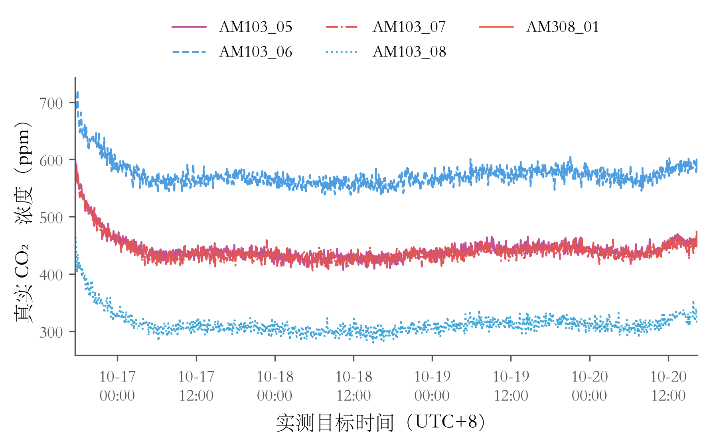
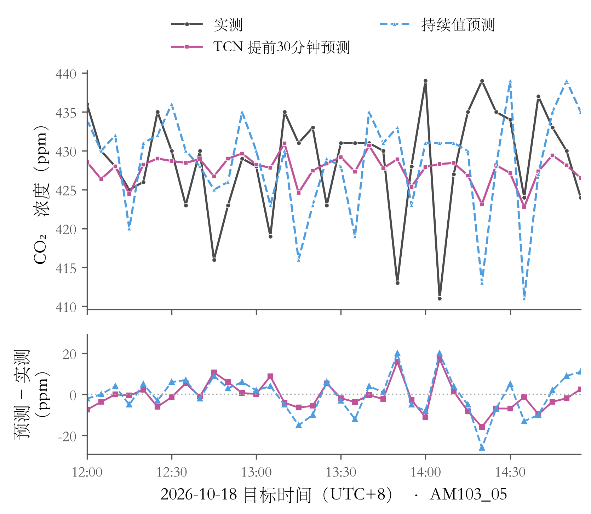
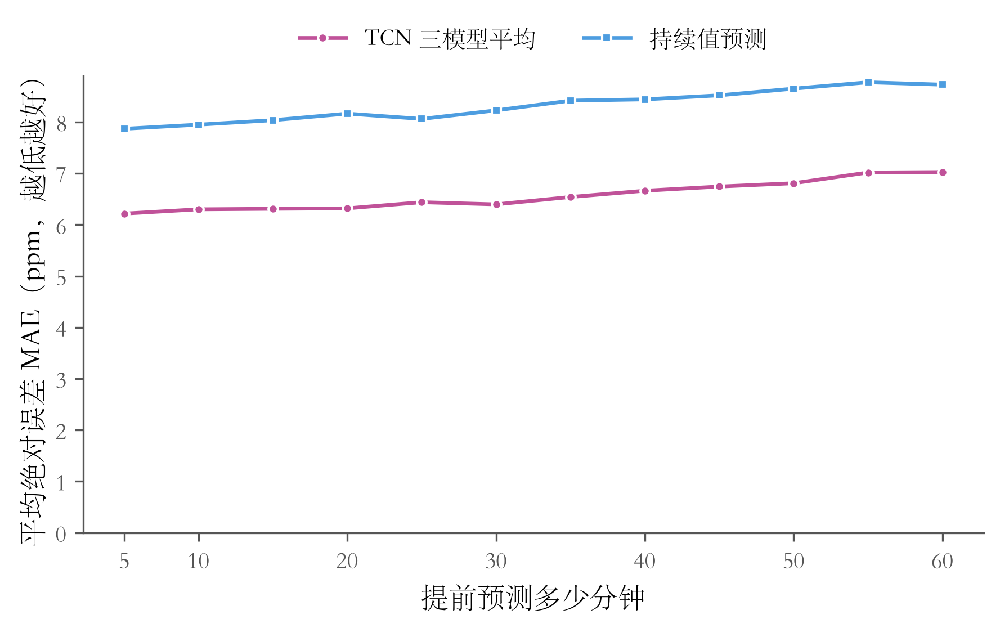
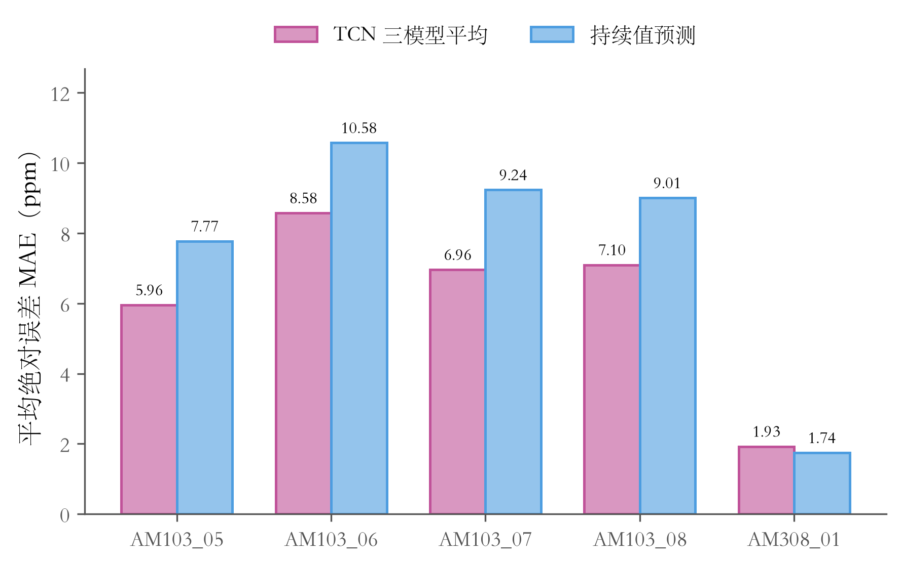
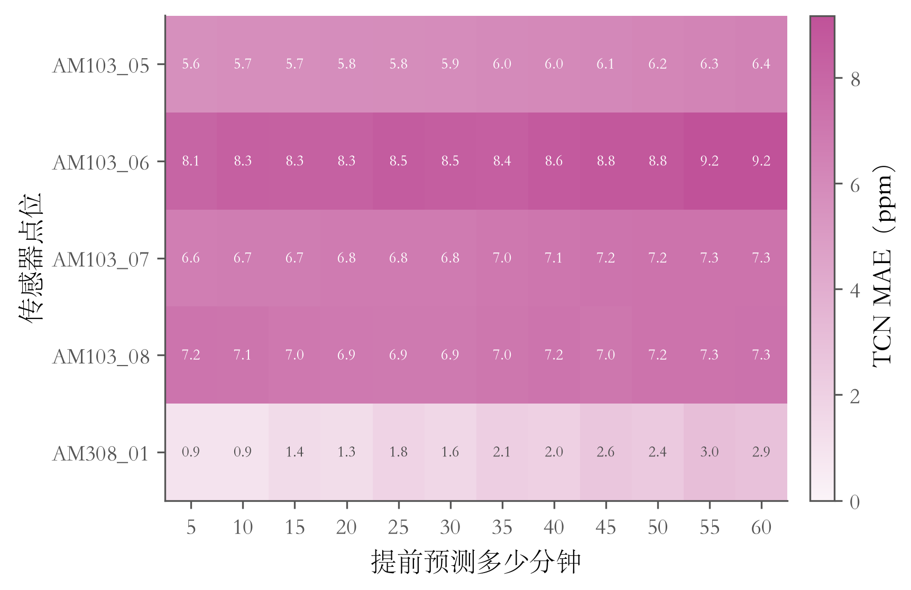
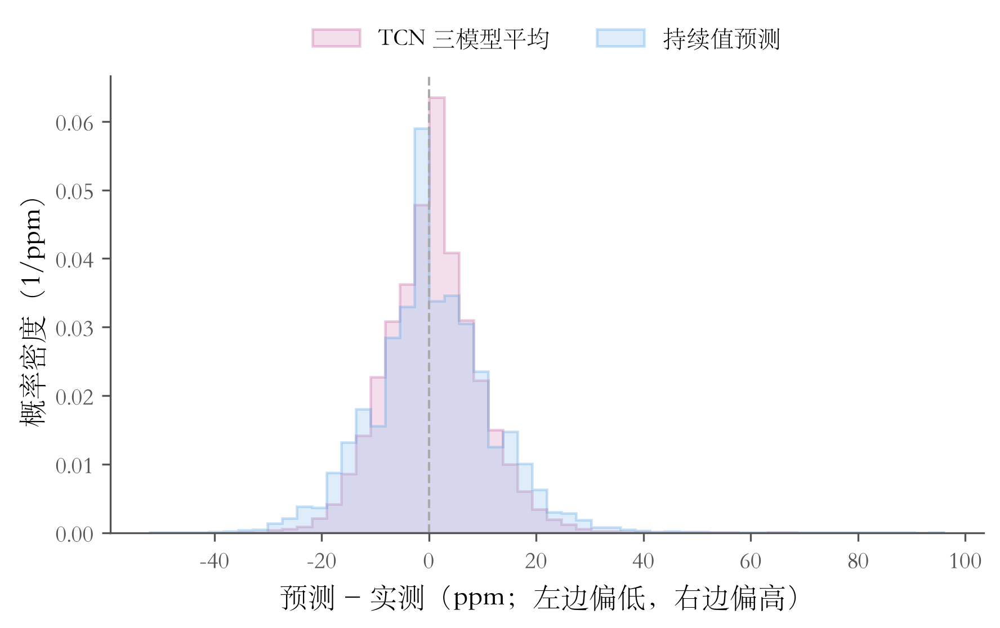
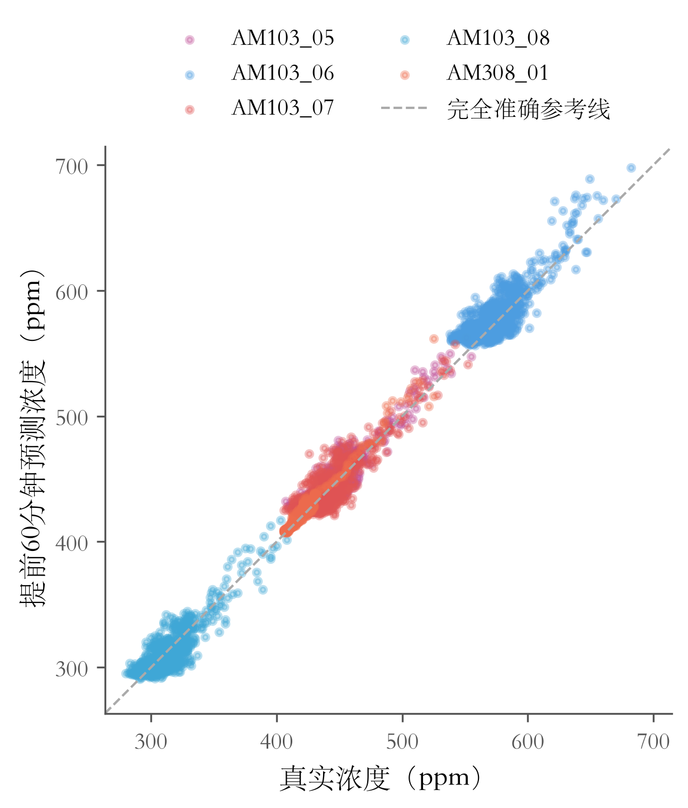

# ZB202 CO₂ 可视化图册

这份图册使用**真实新增时段的冻结确认结果**，没有重新训练，也没有使用模拟数据。

## 先看结论

- TCN平均绝对误差：**6.57 ppm**。
- 简单持续值预测误差：**8.32 ppm**。
- 这段确认数据的总体误差下降：**21.1%**。这是误差降幅，不是“准确率”。
- AM308_01仍略差于简单预测；四天数据不能证明长期或极端高浓度下的表现。

预测起点范围（UTC+8）：2026-10-16T17:25:00+08:00 至 2026-10-20T16:20:00+08:00。图中横轴按未来真实目标时间绘制，可能晚于最后一个预测起点。
共 1140 个重叠预测窗口，61,370 个有效标签项；这些不是相互独立的样本。确认期浓度约280–721 ppm，没有覆盖旧时段9500 ppm尖峰。

“浓度预测”是连续数值预测，没有天然的“答对率”。本图册使用 MAE、RMSE 和偏差。CSV附带“误差在10 ppm以内的比例”，10 ppm仅为读图用的描述容差，不是设备精度或合格标准。

## 1. 五个点位的真实 CO₂ 浓度变化

横轴是时间，纵轴是浓度。每条线对应一个点位；这里展示确认期可用预测起点对应的唯一五分钟真实标签。缺失标签不填补，缺失处断线。点位之间长期存在差异，不能直接认为是校准后相同的房间浓度。



[高清PNG](figures/fig_co2_trend.png) · [PDF](figures/fig_co2_trend.pdf)

## 2. 预测与实测，到底贴得多近？

展示 2026-10-18、AM103_05 的提前30分钟预测，放大固定的 **12:00–15:00** 时间段，每个标记对应一个五分钟格。日期、点位保持原样；放大时段按钟点固定选择，没有按误差挑选，也没有平滑实测数据。

**上图看浓度**：黑色圆点为实测，实线方点为TCN，虚线三角为持续值。**下图看差多少**：对应颜色的误差越靠近零线越好；高于零是猜高了，低于零是猜低了。两种预测都按未来目标时刻与实测对齐。这个局部时段仅供观察曲线，不代表完整确认期的成绩。



[高清PNG](figures/fig_prediction_overlay.png) · [PDF](figures/fig_prediction_overlay.pdf)

## 3. 提前5分钟到60分钟，误差怎么变？

纵轴为 MAE：平均每次预测与实测相差多少 ppm，越低越好。两个方法使用完全相同的真实标签。持续值预测就是“未来仍等于预测起点的当前值”。



[高清PNG](figures/fig_horizon_error.png) · [PDF](figures/fig_horizon_error.pdf)

## 4. 每个传感器，谁预测得更好？

柱子越低越好。前四个点位 TCN 优于持续值，AM308_01 的总体 MAE 略差于持续值。AM308真实标签更稀疏，各点位的样本量可在CSV中查看。



[高清PNG](figures/fig_sensor_error.png) · [PDF](figures/fig_sensor_error.pdf)

## 5. 哪个点位、哪个预测时距更难？

每格是对应点位和时距的 TCN MAE。颜色越深，误差越大。顺序固定为点位顺序和预测时距，没有聚类重排；这是误差矩阵，不是相关矩阵。



[高清PNG](figures/fig_error_heatmap.png) · [PDF](figures/fig_error_heatmap.pdf)

## 6. 模型经常猜高，还是猜低？

偏差定义为预测减实测：左侧是低估，右侧是高估。越集中在零附近越好。覆盖全部有效标签项，包含长尾，没有裁掉极端误差；重叠窗口导致同一真实标签可能多次参与。



[高清PNG](figures/fig_residual_distribution.png) · [PDF](figures/fig_residual_distribution.pdf)

## 7. 提前一小时的预测，和实测是否一致？

每个点是一个有效的60分钟预测与实测配对。越靠近斜虚线越准确；线上方为高估，下方为低估。坐标范围和比例保持一致；不同点位均值差异较大，因此不能仅看总体散点贴近对角线就判断各点位都预测得好。



[高清PNG](figures/fig_prediction_scatter.png) · [PDF](figures/fig_prediction_scatter.pdf)

## 文件在哪里

- `figures/`：7张高清PNG + 7张PDF，可直接用于汇报。
- `data/metrics.csv`：总体、各点位和各时距的MAE、RMSE、偏差与标签量。
- `data/horizon_sensor_mae.csv`：热力图的全部数值和基线对照。
- `data/real_co2_confirmation.csv`：确认期唯一目标时刻的五点真实浓度，空值保持空缺。
- `data/provenance.json`：数据来源、哈希、日期范围与重算结果。
- `scripts/`：可重复运行的绘图和指标导出脚本。
- `generate.py` 是总入口；`scripts/_figbase.py` 集中数据校验和绘图，单图脚本复用同一口径。

## 怎么重新生成

在本目录运行：

```sh
python generate.py
```

环境需安装 `requirements.txt` 中的依赖。当前已验证的本机Python为 `/opt/homebrew/Caskroom/miniforge/base/bin/python3.13`。源数据和冻结产物必须仍保留在项目原位置。

单图可运行 `python scripts/gen_fig_sensor_error.py`。绘图不会修改数据库、原始数据或模型权重。

## 来源和检查

来源：项目 `artifacts/forecasting/20261020T092656Z-confirmation-25df244e/predictions.npz` 与同目录 `manifest.json`。仅使用真实标签掩码内数据；已校验预测文件SHA-256，并重算总体MAE，与冻结报告一致。

绘图使用 vivid-figures-skill 的风格与配方，目录结构采用 codebase-design。没有名称恰好为codebase-structure的本机skill。未估计预测置信区间，因此没有绘制置信带。数据只反映历史运行条件下的预测，不能证明改变阀门动作后的效果。

## 检查记录

已校验冻结NPZ哈希，重算总体、逐点及10/30/60分钟MAE与原manifest一致；已查看七张PNG与PDF渲染，检查文字及图例。第2图按固定午间时段修订，并核验其余六图文件哈希未变。图形布局规划保留在`PAPER_PLAN.md`，不再分散维护结构与检查报告。
